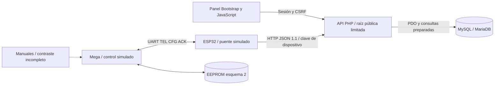

# Arquitectura general: base auditada 0.4.7

Estado de operación: **solo simulación**. La arquitectura prevista conserva al Mega como autoridad local y al ESP32 como puente; el código aún no reproduce la centralita original completa. [Auditoría y bloqueos](../auditoria/BLOQUE_1.md).

| Área | Implementado | Pendiente crítico o límite |
| --- | --- | --- |
| Control local | Sensores y salidas simulados, cache EEPROM, parser, perfiles de sinfín, alarmas enclavadas | FSM original completa, sensores físicos, sinfín 2, recetas, watchdog, recuperación de apagón, protecciones independientes |
| Conectividad | Parser JSON tipado, configuración compacta persistida, reenvío periódico y ACK parcial | TLS y CA, antigüedad de datos, cola durable, comandos con ACK y deduplicación |
| Backend | Roles vigentes, sesión/CSRF, claves por UID, validación, repositorios, migración SQL | ACL por dispositivo si cambia el modelo de instalación; despliegue y operación seguros |
| Interfaz | Login, consulta de snapshot, escape HTML, calidad y edad de muestra | Pantallas administrativas funcionales completas, control real y pruebas de navegador |
| Persistencia | Esquema InnoDB y migración 0.4.7, JSON de evidencia, relaciones FK | Retención, copias/restauración y trazabilidad integral de aplicación de configuración; migración ya probada en MariaDB local y MySQL 8.4 CI |

La raíz HTTP es `server/public`; el router publica endpoints de `server/api` por lista de rutas acotada. `app`, `sql`, `.env` y `storage` no forman parte de la raíz pública. La web se sirve separadamente durante desarrollo con CORS limitado a los orígenes locales documentados; las cookies Secure requieren configurar correctamente HTTPS en el despliegue.

El hardware inventariado es información heredada del repositorio, no verificación física. Solo UART tiene correspondencia de pines en código; su cableado y niveles necesitan comprobación de banco. No hay salida de caldera ni carga habilitada. El esquema original de la página 27 del UTENTE aportado por el propietario sigue inaccesible.
